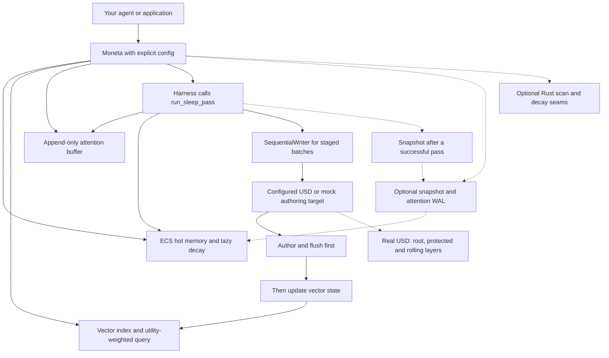
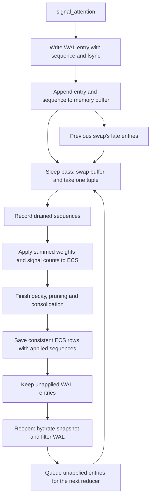

<p align="center">
  
</p>

# Moneta

**Long-term memory for LLM agents. Keep useful memories. Let unused ones fade.**

Moneta is a Python library with working memory in RAM, utility-weighted retrieval,
and optional durable storage and OpenUSD authoring. Your app supplies the embeddings.
Moneta makes no LLM calls.

## Start here

- **Get the stable release:** [v1.3.0 release](https://github.com/JosephOIbrahim/Moneta/releases/tag/v1.3.0).
- **Read its source:** [exact v1.3.0 tree](https://github.com/JosephOIbrahim/Moneta/tree/v1.3.0).
- **Check the evidence:** [release notes and limitations](https://github.com/JosephOIbrahim/Moneta/blob/v1.3.0/RELEASE_NOTES.md).
- **Using Houdini?** Read [the adoption gate](#before-using-houdini) first.

> **Branch matters.** This landing page describes the stable **v1.3.0** release
> (the `v1.3.0-rc2` source, promoted unchanged).
> The code on `main` is still the older v1.2-era line, based on `6cf05f5`.
> Updating this page does not upgrade that code. Use the pinned checkout below.
> [The previous main README](README-main-history.md) is retained as historical reference.

## What it does

1. **Deposit** a memory and its embedding.
2. **Query** memories by relevance weighted by utility.
3. **Signal attention** when a memory helped.
4. **Read the consolidation manifest** to inspect staged memories.

Your harness calls `run_sleep_pass()` to reduce attention, decay utility, prune,
and consolidate. It is a harness operation, not a fifth agent operation.

No daemon starts automatically. A durable handle saves after a successful sleep
pass; an optional background snapshot saver must be started explicitly.

## Try it in three steps

### 1. Check out the exact release

Python 3.11+ is declared. The v1.3.0 results below are for **CPython 3.14.2**, not
a promise that every supported interpreter has been qualified.

```bash
git clone https://github.com/JosephOIbrahim/Moneta.git
cd Moneta
git checkout --detach v1.3.0
git rev-parse HEAD
python -m pip install -e ".[dev]"
```

Expected commit: `4f7afc73736aecce6d55d5e03f28fb3137d474d3`.
Its Python and Rust source is identical to `v1.3.0-rc2` (`aae303b5`).

### 2. Run the smoke check

```bash
python -c "import moneta; moneta.smoke_check(); print('OK')"
```

**Success looks like `OK`.** This exercises the in-memory/mock path, not Houdini
qualification or power-loss recovery.

### 3. Try the API

```python
import moneta

# In-memory example: no persistence and no pxr required.
with moneta.Moneta(moneta.MonetaConfig.ephemeral(native="off")) as memory:
    vector = [1.0, 0.0, 0.0]  # Replace with your embedder's output.
    eid = memory.deposit("The user prefers concise answers.", vector)
    hits = memory.query(vector, limit=5)
    memory.signal_attention({eid: 0.3})

    # Called by your harness at its chosen consolidation time.
    result = memory.run_sleep_pass()
    staged = memory.get_consolidation_manifest()
```

For disk-backed settings, real USD, native wheels and recovery, use the
[v1.3.0 API reference](https://github.com/JosephOIbrahim/Moneta/blob/v1.3.0/docs/api.md) and
[operator card](https://github.com/JosephOIbrahim/Moneta/blob/v1.3.0/docs/OPERATOR_CARD_native.md).
The hot tier works without `pxr`; the real USD target requires compatible OpenUSD
Python bindings. The optional Rust wheel accelerates scan and decay.

**Stuck?** Try `python3` if `python` is missing. Use `python -m pytest` if
`pytest` is not on PATH. A bare `Moneta()` is deliberately invalid: pass a config.

## What v1.3.0 ships

- **Attention durability:** pending attention survives normal keyed saves and
  restarts; late entries are carried forward or recovered on reopen.
- **WAL first:** durable signals write and fsync the attention log before buffering.
- **USD reopen:** existing layers, sublayer order, offsets and counts are retained.
  Save failures raise instead of silently allowing the batch's vector commit.
- **Native visibility:** per-handle status, build identity and pytest verdicts show
  whether the native seams actually ran.
- **API unchanged:** the v1 four-operation surface stays intact.
  **v5 remains a gated preview**, not a replacement production API.

Details, review findings and unresolved work:
[v1.3.0 release notes](https://github.com/JosephOIbrahim/Moneta/blob/v1.3.0/RELEASE_NOTES.md).

## Test evidence, not a blanket guarantee

Re-run **2026-10-19 at the v1.3.0 release commit, on Windows, CPython 3.14.2, pxr 0.26.5**
(first recorded for rc2 on 2026-10-18, same counts):

- Wheel installed, `MONETA_NATIVE=1`: **907 passed**, native qualified.
- Wheel installed, `MONETA_NATIVE=require`: **907 passed**, native qualified.
- Wheel installed, `MONETA_NATIVE=0`: **907 passed**, Python-only, not native qualified.
- No wheel or broken wheel, default mode: **836 passed + 71 visible skips**.
- No wheel or broken wheel with `require`: refused with exit 4, not a passing run.
- v5 mutation check: `missed: []`.
- **hython rows: not run. v1.3.0 is not Houdini-qualified.**

No release commit since merge commit `3c01cf2` changes Python or Rust source, so
the source digest is the same. No installer or new wheel was built for v1.3.0.
[Full matrix and wheel identity](https://github.com/JosephOIbrahim/Moneta/blob/v1.3.0/RELEASE_NOTES.md#0--promotion-from-v130-rc2-to-v130).

## Before using Houdini

**Do not move a Houdini seat to v1.3.0 until gate 2 condition C3 is completed:**

- Run the required hython row on **Houdini H22.0.400**.
- Include a **LOP network sublayering `cortex_root.usda`**.
- Record the result against the exact release source and runtime.

C1 (checked USD saves) and C2 (registry-sharing diagnostics and operator rule)
are met. **C3 is still pending.** Earlier integration evidence is not v1.3.0
qualification.

LOP networks must **not edit or reload `.moneta/usd` layers during a live
session**. Shared layers are detected at construction and logged, not refused;
layers loaded later can escape detection.
[Operator rules](https://github.com/JosephOIbrahim/Moneta/blob/v1.3.0/docs/OPERATOR_CARD_native.md).

## Know the limits

- **Windows power loss:** no directory fsync. A save's renames can roll back,
  and a signal appended after a rolled-back WAL rename can be lost.
- **macOS power loss:** `os.fsync` does not flush the drive write cache;
  Moneta does not call `F_FULLFSYNC`. Acknowledged signals or saves can be lost.
- **Downgrading to rc1:** quiesce signals, run `m.run_sleep_pass()`, close, then
  verify the WAL is absent or empty. Otherwise pending attention can be lost.
  R1′ → v5 facade → R1′ is unsupported.
- **USD failure in v1:** staged entities can remain stranded after a failed save;
  later v1 passes do not automatically recommit that batch. Inspect the manifest.
- **Concurrency:** one process per store and one reducer at a time.
  In-process URI/path checks are not cross-process locks. Free-threaded Python
  is unsupported.
- **Failure windows:** degraded/keyless saves fall back to timestamp replay;
  interrupts can produce documented loss or phantom-apply windows.
  Normal keyed replay is not an unconditional exactly-once guarantee.
- **Loss bound:** the 30-second volatile-state target needs saves at least every
  30 seconds. Closing a handle alone is not a substitute for a successful save.

[Read the complete limits and rollback guidance](https://github.com/JosephOIbrahim/Moneta/blob/v1.3.0/RELEASE_NOTES.md#honest-limits).

## Architecture at a glance

**Scope: v1 handle in the v1.3.0 source**, not the older code on `main`
and not the v5 preview. Optional paths are labeled.



The USD mirror is not the startup database for the v1 handle: reopening hydrates
ECS from the snapshot and attention WAL, then rebuilds the vector index.
The real USD target separately reopens its existing layers.
[Source: handle](https://github.com/JosephOIbrahim/Moneta/blob/v1.3.0/src/moneta/api.py),
[sequential writer](https://github.com/JosephOIbrahim/Moneta/blob/v1.3.0/src/moneta/sequential_writer.py).

### Attention: signal, apply, save, reopen

**Normal durable/keyed path.** Ephemeral handles skip the WAL. The failure
exceptions listed above still apply.



Late entries normally land in the next pass. A longer-stalled appender may need
a reopen for recovery; its WAL line survives normal keyed saves.
Sequences are recorded **before** applying attention: a torn apply is logged
and can lose an effect rather than silently double-apply it.
[Source: reducer](https://github.com/JosephOIbrahim/Moneta/blob/v1.3.0/src/moneta/attention_log.py),
[durability](https://github.com/JosephOIbrahim/Moneta/blob/v1.3.0/src/moneta/durability.py),
[design](https://github.com/JosephOIbrahim/Moneta/blob/v1.3.0/docs/design/R1-attention-durability.md).

## Go deeper

**For the v1.3.0 release code**
- [API and configuration](https://github.com/JosephOIbrahim/Moneta/blob/v1.3.0/docs/api.md)
- [Native operator card and rollback table](https://github.com/JosephOIbrahim/Moneta/blob/v1.3.0/docs/OPERATOR_CARD_native.md)
- [Release notes, reviews and open items](https://github.com/JosephOIbrahim/Moneta/blob/v1.3.0/RELEASE_NOTES.md)
- [v5/v7 rulings](https://github.com/JosephOIbrahim/Moneta/blob/v1.3.0/docs/v7/RULINGS.md)
- [Decay tuning](https://github.com/JosephOIbrahim/Moneta/blob/v1.3.0/docs/decay-tuning.md)

**For history and the older main line**
- [Preserved main README, historical diagrams and phase results](README-main-history.md)
- [Main API reference](docs/api.md)
- [SYNAPSE v5.67.2 integration record](docs/synapse-loop.md)
- [Blueprint](MONETA.md) and [locked architecture](ARCHITECTURE.md)
- [Shared substrate conventions](docs/substrate-conventions.md)

Moneta is memory; sibling Octavius is coordination. They compose through the
USD stage, not shared Python imports. The name recalls Juno Moneta, associated
with warning and memory: memory as advisory, not just storage.

## License

Proprietary. Patents pending.
