<p align="center">
  
</p>

# Moneta

**Long-term memory for LLM agents. Keep useful memories. Let unused ones fade.**

Moneta is a Python library. Working memory lives in RAM, retrieval is weighted by utility, and durable storage and OpenUSD authoring are optional. Your app supplies the embeddings. Moneta makes no LLM calls.

> **Stable release: `v1.3.0`** (2026-10-19), from branch `release/v1.3.0`.
> Its Python and Rust source is identical to the `v1.3.0-rc2` candidate. Only the version and the docs changed.
> **`main` still carries the older v1.2-era code.** Check out the tag, not `main`.

---

## Start here

| I want to… | Go to |
|---|---|
| **Get the release** | [v1.3.0 on GitHub](https://github.com/JosephOIbrahim/Moneta/releases/tag/v1.3.0) · `git checkout v1.3.0` |
| **Run it in about 60 seconds** | [Quick start](#quick-start--about-60-seconds-three-steps) |
| **See what changed** | [What v1.3.0 ships](#what-v130-ships) · [RELEASE_NOTES.md](RELEASE_NOTES.md) |
| **Know what it does not promise** | [Know the limits](#know-the-limits) |
| **Use it from Houdini** | [Before using Houdini](#before-using-houdini). Read this before you move a seat. |
| **Check the test evidence** | [Test evidence](#test-evidence-not-a-blanket-guarantee) |

---

## TL;DR

**You're building an LLM agent.** It needs memory that:

- **Lasts past turn 30.** Facts learned in turn 3 are still there.
- **Forgets the noise.** Old, unused memories fade; reinforced ones stick.
- **Doesn't drown the prompt.** Retrieval ranks by *relevance × utility*, not raw similarity.
- **Splits hot from cold.** Working memory in RAM. Durable storage on disk.

**Moneta is a Python library.** You hold a handle, you call four operations:

```python
import moneta

with moneta.Moneta(moneta.MonetaConfig.ephemeral()) as m:
    eid = m.deposit("the user prefers concise answers", embedding=[...])
    results = m.query(embedding=[...], limit=5)
    m.signal_attention({eid: 0.3})       # this memory was useful
    m.run_sleep_pass()                   # your harness consolidates
```

**Four agent operations, full stop.** `run_sleep_pass()` is a harness call, not a fifth operation. **No LLM calls inside. No daemon starts by itself:** a durable handle saves after each successful sleep pass, and the optional background saver runs only if you start it.

---

## What v1.3.0 ships

Everything since `v1.2.0-rc3`, the last release on the older line. **The v1 four-operation API and its signatures are unchanged.**

**1 · Attention survives a save and a restart.**
- Every attention log (WAL) line carries a sequence number.
- A save keeps every line the sleep pass has not applied yet. A restart replays it once.
- This fixes three ways rc1 lost attention (defects B, D and L). [Details](#attention-durability-b-d-and-l-fixed).

**2 · The attention log is forced to disk.**
- `signal_attention` writes and fsyncs the WAL before it returns, about 1.2 ms per call on the test workstation.

**3 · The USD mirror reopens instead of resetting.**
- Existing layers open first. Sublayer order, offsets and counts survive.
- `flush()` checks every `Save()`. A failed save raises `UsdSaveError`, and that batch's vector commit does not happen.

**4 · You can see whether Rust actually ran.**
- Optional Rust seams for scan and decay, bit-identical to the Python code. Off with `MONETA_NATIVE=0`.
- `Moneta.native_status`, `moneta.build_info()`, and a verdict line at the end of every pytest run.

**5 · `moneta.v5`, a gated preview.**
- A reference implementation where the journal is the database. **Not a production API yet.** 5.0.0 is not released.

---

## Test evidence, not a blanket guarantee

Re-run on **2026-10-19 at the `v1.3.0` release commit**. Windows, **CPython 3.14.2**, `pxr` 0.26.5, v1 and v5 suites together.

| Configuration | Result |
|---|---|
| Wheel installed, `MONETA_NATIVE=1` | **907 passed** · `NATIVE QUALIFIED` |
| Wheel installed, `MONETA_NATIVE=require` | **907 passed** · `NATIVE QUALIFIED` |
| Wheel installed, `MONETA_NATIVE=0` | **907 passed** · Python only, not native qualified |
| No wheel, or a broken wheel | **836 passed + 71 visible skips** · Python only |
| No wheel or broken wheel, `require` | **Refused, exit 4.** Not a passing run. |
| v5 mutation check | `missed: []` |
| **hython, Houdini 22.0.400** (Python 3.13.10, `pxr` 0.26.5), added 2026-10-19 | **The suite rows above match** (the mutation check was not re-run under hython): 907 passed (`NATIVE QUALIFIED` under `=1` and `=require`), 836 + 71 skips without the wheel, exit 4 under `require`. Run isolated from the SYNAPSE Houdini package. |
| **Houdini gate C3** (a LOP network sublayering `cortex_root.usda`), added 2026-10-19 | **Met** on H22.0.400 in headless hython ([`scripts/houdini/c3_probe.py`](scripts/houdini/c3_probe.py)). Every check passed; see [Before using Houdini](#before-using-houdini). |

**Verify what you run by `commit` + `src_digest` + the wheel's `.pyd` sha256, never by version.** For `v1.3.0`: `src_digest` `58600b5811c7…` and `.pyd` sha256 `ec6d7f0c35c5…` (full values in [Native qualification results](#native-qualification-results-on-this-branch)). Full matrix: [Status](#status).

**No new installer or wheel was built for this release.** The GitHub release carries GitHub's source archives only. The optional `moneta_native` wheel stays at 0.1.0; build it from `rust/moneta_native` (see [native seams](#optional-native-seams-rust)).

---

## Before using Houdini

**Gate 2 is met for v1.3.0 on Houdini H22.0.400** (2026-10-19, commit `4f7afc7`). C1 (checked USD saves) and C2 (registry-sharing diagnostics and the operator rule) were met in code. **C3** now has both halves:

1. **The hython rows.** The full suite under hython 22.0.400 is green in every row (see [Test evidence](#test-evidence-not-a-blanket-guarantee)).
2. **The LOP probe.** [`scripts/houdini/c3_probe.py`](scripts/houdini/c3_probe.py) ran in three separate hython processes against a scratch store. The owner approved these checks as the pass bar:

| C3 check | Result |
|---|---|
| A Sublayer LOP loads `cortex_root.usda` | ✅ The LOP composes the store's 4 memory prims and holds 3 store layers (root, protected, rolling) |
| Moneta logs the sharing | ✅ One `Sdf registry sharing` ERROR per shared layer: 3 |
| Deposit, sleep pass and flush with the LOP present | ✅ 4 memories staged (1 protected), no `UsdSaveError`, no duplicate sublayers |
| Fresh reopen, no LOP | ✅ Same sublayer stack and offsets, 2 protected + 6 rolling prims, nothing stranded in the manifest, 0 sharing errors |
| Fresh LOP in a new process | ✅ Composes all 8 prims |
| LOPs never edit or reload `.moneta/usd` layers | ✅ The probe only re-cooks the node. After Moneta's flush, a re-cook shows the new prims, because the layers are shared. |

**Before you move a seat**, know that this is headless hython, not an interactive session. The probe uses its own scratch store and the default layer offsets. Also, SYNAPSE's seat loads Moneta from a local repo checkout, which is still on `v7-native-seams` (older than `v1.3.0`). Moving a seat means moving that dependency to `v1.3.0`, which is a separate step.

**SYNAPSE's Houdini package sets `MONETA_NATIVE=0`** for every Houdini process, on purpose, so the native wheel stays out of SYNAPSE sessions. Under that package, the 4 harness tests that set `MONETA_NATIVE` themselves fail, because the package overrides them. That's the package's kill switch working, not a Moneta defect. The rows above ran with `HOUDINI_PACKAGE_DIR` pointed at an empty folder.

LOP networks must **not edit or reload `.moneta/usd` layers during a live session**. Shared layers are detected when the target is built and logged at ERROR, not refused. A layer loaded later is not detected. [Operator rules](docs/OPERATOR_CARD_native.md).

---

## Know the limits

- **Windows power loss.** Windows has no directory fsync. A save's renames can roll back, and a signal appended after a rolled-back WAL rename can be lost.
- **macOS power loss.** `os.fsync` does not flush the drive's write cache, and Moneta does not call `F_FULLFSYNC`. A signal that `signal_attention` acknowledged, or a save, can be lost.
- **Downgrading to rc1.** Quiesce signals, run `m.run_sleep_pass()`, `m.close()`, then check that the WAL is absent or empty. Otherwise pending attention is lost. R1′ → v5 facade → R1′ is unsupported.
- **A failed USD save on the v1 handle** leaves that pass's staged entities `STAGED_FOR_SYNC`. Later v1 passes do not commit them again. Check the manifest.
- **One process per store, one sleep pass at a time.** The store-path check is in-process only. Free-threaded Python is unsupported.
- **Failure windows.** An interrupt within a few bytecodes of a WAL write can apply a signal whose call raised. A torn apply is logged and can lose an effect, never silently double it. Keyed replay is not an unconditional exactly-once guarantee.
- **The 30-second loss bound needs a save at least every 30 s.** Closing a handle is not a substitute for a successful save.
- **v5 stays a gated preview** with open conditions (see the [v1.3.0-rc1 verdict](#v130-rc1-verdict)).

[Every limit, with the rollback table](RELEASE_NOTES.md#honest-limits).

> The name invokes **Juno Moneta** — Roman goddess of warning and memory, whose temple housed the Roman mint because she also *reminded*. Memory as advisory, not only storage.

---

## Status

| Phase | Tag | What landed |
|---|---|---|
| **Phase 1** — ECS + four-op API | `v0.1.0` | 94 tests green, 30-min synthetic session clean |
| **Phase 2** — USD benchmark | `v0.2.0` | 243-config sweep, Yellow tier verdict |
| **Phase 3** — Real USD integration | `v1.0.0` | Real USD writer, narrow lock, 775M-assertion safety verification |
| **Singleton surgery** — handle API | `v1.1.0` | Module-level singleton replaced by `Moneta(config)` handle. Multi-instance per process. |
| **Codeless schema migration** — typed `MonetaMemory` prims | **`v1.2.0-rc1`** | USD codeless schema; on-disk prims gain `typeName="MonetaMemory"`, USD camelCase attrs, `priorState` as token. Schema-aware in usdview. |
| **Free-threading guard** — `AttentionLog` PEP 703 sentinel | `v1.2.0-rc2` (commit `76da067`) | `AttentionLog.__init__` raises `RuntimeError` under `sys._is_gil_enabled() is False`. Lock-free swap-and-drain correctness depends on the GIL; guard converts silent failure into a loud one. |
| **Cosine clamp** — query ranking fix | `v1.2.0-rc3` (commit `c4a6218`) | Cosine clamped to `[0, 1]` in ranking. A negative cosine times a positive utility no longer ranks a reinforced memory below a zero-score one. |
| **Native seams + v5 preview** | **`v1.3.0-rc1`** (prerelease) | Optional Rust seams with exact Python oracles. v5 reference implementation (journal as the database) beside v1. Round 4 owner rulings recorded. v1 API unchanged. |
| **Attention durability + native observability** | **`v1.3.0-rc2`** (prerelease) | WAL-first, seq-keyed attention survives a bare save and a restart (B, D and L fixed). WAL appends fsync'd. The USD mirror reopens existing layers first. One native loader, per-handle selection, build identity and a verdict line. v1 API unchanged. |
| **Stable release** | **`v1.3.0`** | `v1.3.0-rc2` promoted unchanged: same source, same `src_digest`, matrix re-run at the release commit. Version and docs only. Houdini gate C3 met on H22.0.400 (hython rows and LOP probe, 2026-10-19). |

**Current version:** `v1.3.0`, stable, from branch `release/v1.3.0` (cut from the `v1.3.0-rc2` tag; `v1.3.0-rc1` came from `v7-native-seams`). `main` is still the older v1.2-era line (`v1.2.0-rc3` plus docs commits) and does not contain this code.

**Test matrix, `v1.3.0`** (v1 and v5 suites together, `src_digest` `58600b5811c7`, wheel `.pyd` sha256 `ec6d7f0c35c5…`). First recorded for `v1.3.0-rc2` on 2026-10-18 at merge commit `3c01cf2`; **re-run on 2026-10-19 at the `v1.3.0` release commit** with the same counts and verdicts in every row below. No release commit since `3c01cf2` changes a `*.py` or `*.rs` file, so the `src_digest` is the same. Full identity and the verdict lines are in [Native qualification results](#native-qualification-results-on-this-branch).

| Interpreter | `MONETA_NATIVE` unset | `MONETA_NATIVE=0` | `MONETA_NATIVE=1` | `MONETA_NATIVE=require` |
|---|---|---|---|---|
| Python 3.14.2, wheel | not run | 907 passed · `PYTHON-ONLY PASS` | 907 passed · `NATIVE QUALIFIED` | 907 passed · `NATIVE QUALIFIED` |
| Python 3.14.2, **no wheel** (absent) | 836 passed, 71 skipped · `PYTHON-ONLY PASS` | not run | not run | exit 4: refused, wheel not loaded |
| Python 3.14.2, **broken wheel** (`ImportError`) | 836 passed, 71 skipped · `PYTHON-ONLY PASS` | not run | not run | exit 4: refused, wheel broken |
| hython 22.0.400 (Python 3.13.10), wheel | not run | 907 passed · `PYTHON-ONLY PASS` | 907 passed · `NATIVE QUALIFIED` | 907 passed · `NATIVE QUALIFIED` |
| hython 22.0.400, **no wheel** / **broken wheel** | 836 passed, 71 skipped · `PYTHON-ONLY PASS` | not run | not run | exit 4: refused |

**No xfails remain.** Defects B and D ran as 2 strict xfails through the hardening; they now pass unmarked. See [Attention durability](#attention-durability-b-d-and-l-fixed).

*Earlier counts: `v1.3.0-rc1` recorded 405 passed in four configurations and 347 + 35 skipped without the wheel (2026-10-15), before the qualification harness, so those runs could not tell whether Rust ran. The native-observability hardening recorded 779 passed + 2 xfailed with the wheel and 708 passed + 71 skipped + 2 xfailed without it (2026-10-16, commit `98a998f084eb`).*

**v5 mutation check:** `scripts/v5/mutation_check.py` reports `missed: []` (every planted mutation is caught).

Sibling project: [Octavius](https://github.com/JosephOIbrahim) (coordination substrate on the same USD thesis). Moneta is memory; Octavius is coordination. They share [substrate conventions](docs/substrate-conventions.md) but not Python code — the stage is the interface.

---

## Quick start — about 60 seconds, three steps

You'll have it cloned, smoke-tested, and (optionally) green on the test suite by the end of this section.

### 1. Install

```bash
git clone https://github.com/JosephOIbrahim/Moneta.git
cd Moneta
git checkout v1.3.0        # the stable release; main is the older line
pip install -e .[dev]
```

Python ≥ 3.11. **Zero runtime dependencies** for the hot tier — no numpy, no torch, no DB drivers. Stdlib only. The Phase 3 USD writer needs `pxr` from a bundled OpenUSD distribution, but you can ignore that until you want to write to disk.

### 2. Smoke check

```bash
python -c "import moneta; moneta.smoke_check(); print('OK')"
```

**You're good when you see `OK`.** That means the four ops, decay math, attention reducer, sleep pass, and consolidation are all wired.

### 3. Run the tests (optional)

```bash
pytest
```

**You should see every test pass or skip, with no failures.** The exact count depends on two things:

- **Is `pxr` importable?** USD tests use `pytest.importorskip("pxr")`, so they skip under plain Python and run under hython (OpenUSD 0.25.5).
- **Is the `moneta_native` wheel installed?** Native-only tests skip without it.

With the wheel and `pxr` present on Python 3.14, the full suite is **907 passed**, with no xfails. The last lines of the summary print a native verdict. See the [test matrix](#status) for each configuration.

### Stuck?

| Symptom | Fix |
|---|---|
| `python: command not found` | Try `python3`, or install Python from [python.org](https://www.python.org/downloads/) |
| `No module named 'moneta'` | Run `pip install -e .[dev]` from the Moneta directory |
| `pytest: command not found` | Run `python -m pytest` |
| `TypeError: Moneta() missing 1 required ... 'config'` | That's by design (§5.3 of the design brief — no implicit defaults). Pass `MonetaConfig.ephemeral()` for tests. |
| `ModuleNotFoundError: moneta_native` | Fine in the default auto mode: Moneta runs the pure-Python path. Build the wheel (see [native seams](#optional-native-seams-rust)) only if you want the speed. Under `require`, a missing wheel raises `NativeUnavailableError` instead. |
| `No module named 'moneta.v5'` in subprocess tests | A stale `site-packages/moneta` is shadowing the repo. Run from the repo root with `PYTHONPATH=src`. |

---

## The four-op API

The entire agent-facing surface. Agents have **zero knowledge** of ECS, USD, vector indices, decay, or consolidation.

| Operation | Signature | Returns |
|---|---|---|
| `deposit` | `(payload: str, embedding: List[float], protected_floor: float = 0.0)` | `UUID` |
| `query` | `(embedding: List[float], limit: int = 5)` | `List[Memory]` |
| `signal_attention` | `(weights: Dict[UUID, float])` | `None` |
| `get_consolidation_manifest` | `()` | `List[Memory]` |

These are methods on the `Moneta` handle. Plus one harness-level operator:

| Operation | Signature | What it does |
|---|---|---|
| `run_sleep_pass` | `()` | Drains attention log, applies decay, prunes/stages survivors |

### Hello world

```python
import moneta

# Construct a handle. Each handle owns one storage_uri; two handles
# on the same URI raise MonetaResourceLockedError.
with moneta.Moneta(moneta.MonetaConfig.ephemeral()) as m:
    eid = m.deposit(
        payload="The user prefers concise explanations.",
        embedding=[0.12, -0.45, 0.78, ...],   # from your embedder
    )

    # Retrieve by semantic similarity (utility-weighted)
    results = m.query(embedding=[0.12, -0.45, 0.78, ...], limit=5)
    for memory in results:
        print(memory.payload, f"u={memory.utility:.2f}", f"a={memory.attended_count}")

    # Tell Moneta this memory was useful (async — applied at next sleep pass)
    m.signal_attention({eid: 0.3})

    # Periodic consolidation (drain attention log, decay, prune/stage)
    result = m.run_sleep_pass()
    print(f"pruned={result.pruned} staged={result.staged}")
```

### Why a handle?

Before `v1.1.0` Moneta exposed module-level functions backed by a singleton — one substrate per process. The handle (`v1.1.0`) lifts that limit:

- **Multiple instances per process.** Run two agents side-by-side, or one substrate per tenant in a hosted setup.
- **Explicit lifecycle.** `with Moneta(config) as m:` is the canonical form. `__exit__` releases all resources and the in-process URI lock.
- **No-arg trap.** `Moneta()` raises `TypeError` by design — every consumer declares its storage boundary on line one. Use `MonetaConfig.ephemeral()` for tests.
- **Two handles on the same `storage_uri` raise.** In-memory `_ACTIVE_URIS` registry. No silent sharing.

Full design rationale: [`DEEP_THINK_BRIEF_substrate_handle.md`](DEEP_THINK_BRIEF_substrate_handle.md). Surgery record: [`SURGERY_complete.md`](SURGERY_complete.md).

Full API reference with usage examples: [`docs/api.md`](docs/api.md).

SYNAPSE's optional three-substrate memory LOOP borrows its existing Moneta owner
and recalls durable outcomes on subsequent operations. See the
[SYNAPSE v5.67.2 integration record](docs/synapse-loop.md) for qualified source
versions, ownership rules, recovery checks and artist-control boundaries.

---

## How it works (architecture)

### System overview

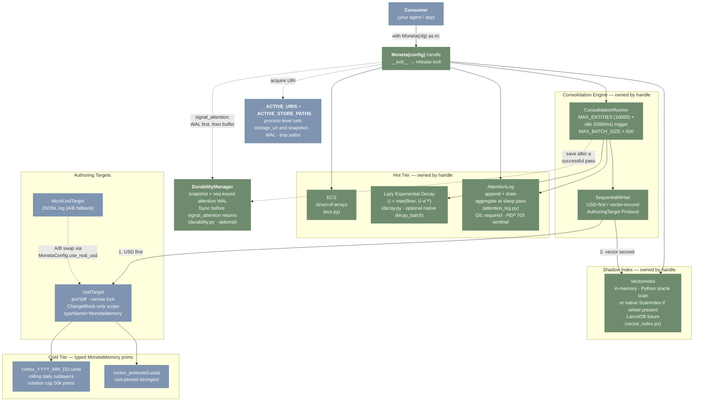

### Handle lifecycle (`v1.1.0`)

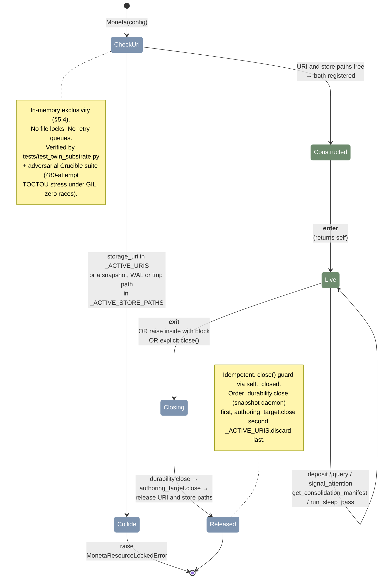

### Multi-instance support (`v1.1.0`)

The marquee `v1.1.0` capability — **N substrates per Python process**. Each handle owns its `storage_uri`; the in-memory `_ACTIVE_URIS` registry refuses any second handle that tries to claim a URI that's already taken.

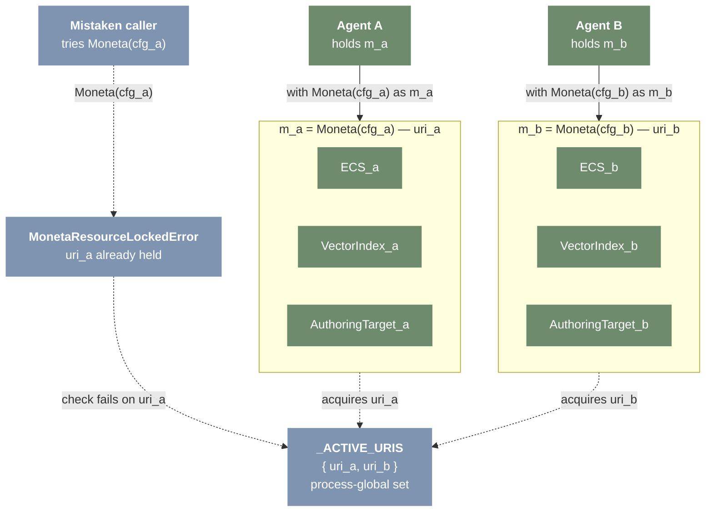

Substrates are **physically distinct objects** under the hood — `m_a.ecs is not m_b.ecs`, same for `attention`, `vector_index`, `authoring_target`. A deposit on `m_a` is invisible to `m_b`. A protected-quota slot used in `m_a` does not consume `m_b`'s quota. Verified by `tests/test_twin_substrate.py` (mock disk-backed + real-USD under hython) and `tests/test_twin_substrate_adversarial.py` (anonymous mode + three-handle collision + thread-boundary survival + reconstruct-after-close freshness + Sdf.Layer pointer distinctness).

### Memory lifecycle

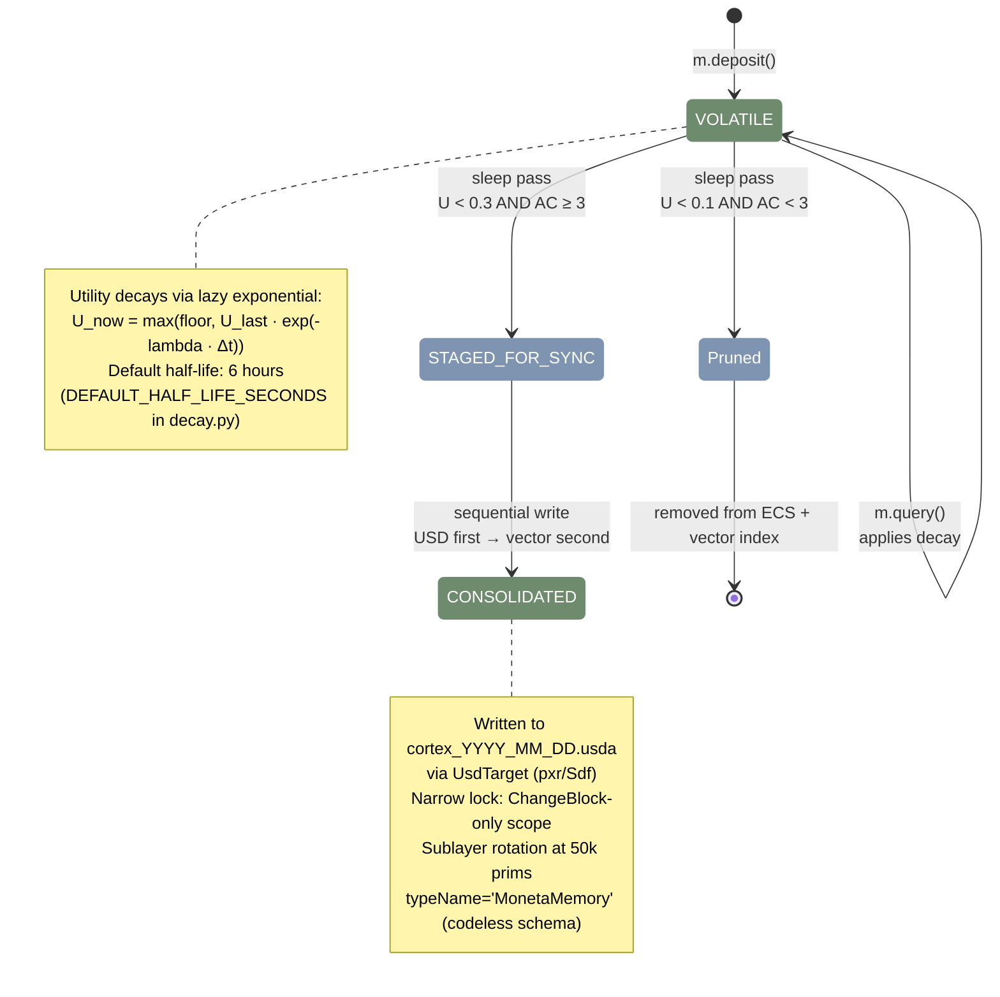

### Consolidation sleep-pass flow

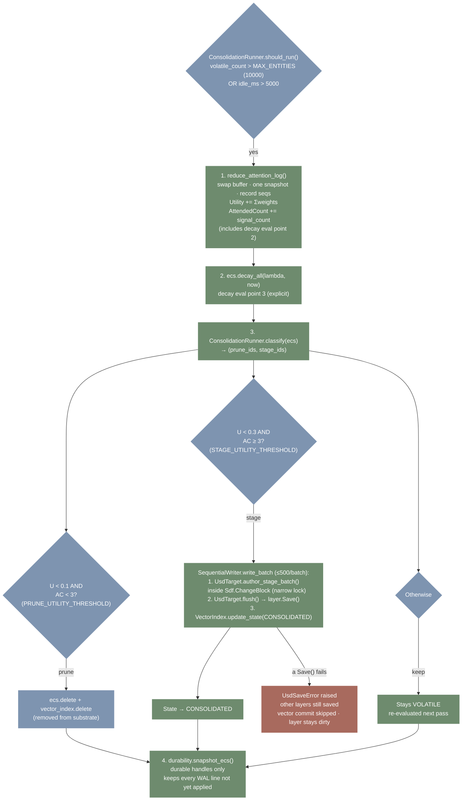

### Protocol injection — dual-target architecture

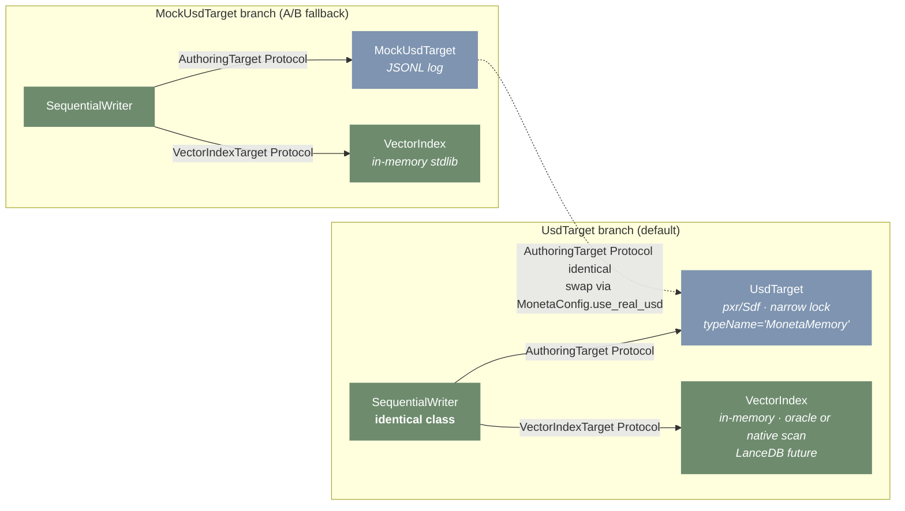

### Codeless schema architecture (`v1.2.0-rc1`)

The on-disk shape of consolidated memory prims. Codeless: no C++ build, no Python codegen — pure runtime registration through OpenUSD's plugin system. The Sdf write path is **schema-blind by design** (`Sdf.AttributeSpec` + `prim_spec.typeName = "MonetaMemory"` writes the string regardless of registration); the **`Usd.SchemaRegistry` boundary** is what makes it real. The acceptance gate test asserts both halves in a clean subprocess.

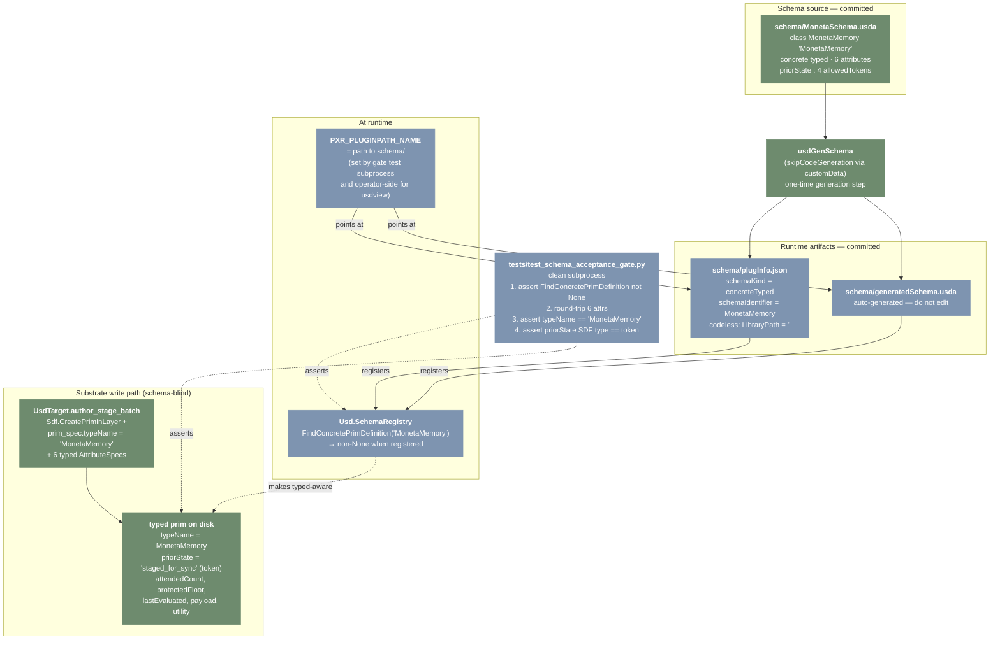

The C++ `Sdf.Layer` registry (the v1.1.0 trap) and this codeless plugin registry live in the same OpenUSD runtime but are independent. `_ACTIVE_URIS` (v1.1.0) gates handle construction; `Usd.SchemaRegistry` (v1.2.0-rc1) gates type recognition. The `pruned` token in `allowedTokens` is forward-looking — `EntityState` has no `PRUNED` member today; `_token_to_state("pruned")` raises rather than silently mapping to a wrong state.

### Substrate family

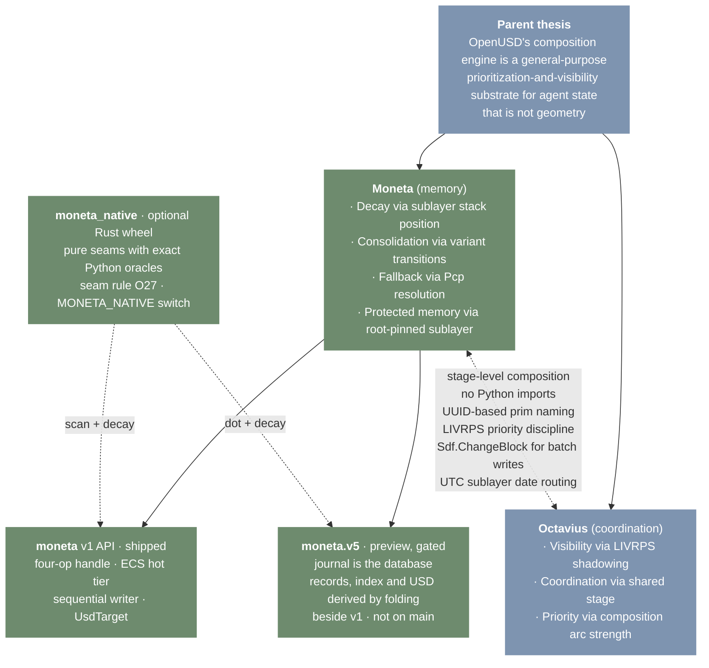

---

## Decay model

Lazy memoryless exponential, evaluated at access time only — never on a background tick.

```
U_now = max(ProtectedFloor, U_last · exp(-λ · (t_now - t_last)))
```

| Time since deposit | Utility (no reinforcement, 6h half-life) |
|--------------------|------------------------------------------|
| 0 min | 1.000 |
| 30 min | 0.944 |
| 1 hour | 0.891 |
| 3 hours | 0.707 |
| 6 hours | 0.500 |
| 12 hours | 0.250 |
| 24 hours | 0.063 |

`signal_attention()` boosts utility and increments attended count. Memories that are actively reinforced survive; unreinforced memories decay toward pruning.

Tuning guide: [docs/decay-tuning.md](docs/decay-tuning.md)

---

## Optional native seams (Rust)

`rust/moneta_native` is an optional PyO3 wheel (abi3, so one build serves CPython 3.11 and later). It runs the hottest loops in Rust. **Each seam has an exact Python oracle**, and the conformance suites require bit-identical results, ties included. It is a drop-in: without it, or with `MONETA_NATIVE` set to an off value (`0`, `false`, `off`, `no`), Moneta runs pure Python as before. **Installed is not the same as running:** each handle reports what actually ran in `Moneta.native_status`, and the test suite ends with a native verdict line.

### The seam rule (O27, owner-confirmed 2026-10-15)

**Rust enters only behind a pure seam with an exact Python oracle, where it buys speed or a guarantee.**

- The Python code is the oracle. If a conformance test goes red, the Rust is wrong, never the test.
- The seams are on by default when the wheel is installed, behind the `MONETA_NATIVE` switch.
- The same rule governs any future native crate.

### The four seams

| Seam | Rust function | Python oracle | Parity test (the contract) |
|---|---|---|---|
| **v1 scan** — `VectorIndex(backend="auto")` | `moneta_native.ScanIndex.scan` | `_oracle_scan` in `vector_index.py` | `tests/unit/test_native_scan_conformance.py` |
| **v1 decay** — `ECS.decay_all` | `moneta_native.decay_batch` | `decay_value` in `decay.py` | `tests/unit/test_native_decay_parity.py` |
| **v5 dot** — `ExactIndex.cosines` | `moneta_native.ScanIndex.dots` | the Python loop in `ExactIndex.cosines` (`v5/index.py`) | `tests/v5/test_native_index_parity.py` |
| **v5 decay** — `moneta.v5.model.utilities_at` | `moneta_native.decay_batch` | `Record.utility_at` (`v5/model.py`) | `tests/v5/test_native_decay_parity.py` |

`tests/unit/test_rank_early_stop.py` is the fifth contract file: it pins the exact early-stop rerank that every v1 path shares.

**How bit-exact works:** the Rust sum reproduces CPython's own `sum()`. That is sequential left-to-right on Python 3.11, and Neumaier-compensated on Python 3.12 and later. So native results match the Python path on whichever interpreter is running.

**Edge cases (auto mode, the default):**

- A non-finite, non-numeric or empty vector permanently demotes that index to the Python backend. Answers stay exact; that index is now on the slow path. One WARNING is logged per handle and reason, and `native_status.scan` shows `demoted=True` with a `demoted:<reason>` fallback count.
- A finite but huge component (around `1e308`) can overflow to a NaN cosine. That one query is answered by the oracle and counted as `cosine_overflow`.
- If native decay fails with a known native error, the oracle runs on the unchanged columns, decay is demoted for that handle, and the failure is counted as `decay_error:<ExcType>`.

Under `require`, demotion is forbidden; see [What `require` means](#what-require-means).

### The switch: `MONETA_NATIVE` and `MonetaConfig.native`

**The environment variable** is stripped and lower-cased, then read as one of five classes:

| Class | Values | Asks for |
|---|---|---|
| **UNSET** | variable not set | auto (the default) |
| **AUTO** | `""`, `1`, `true`, `on`, `yes`, `auto` | auto: native when the wheel loads, otherwise Python |
| **OFF** | `0`, `false`, `off`, `no` | off: Python only; the handle never imports `moneta_native` |
| **REQUIRE** | `require` | require: native, or a loud error |
| **UNKNOWN** | anything else | auto, plus one `RuntimeWarning` per process; the raw value is shown in status |

> **Behaviour change.** `false`, `off` and `no` used to turn native **on** (only the exact string `0` meant off). They now mean **off**. `1` still means auto.

**The config field** is `MonetaConfig.native: None | "auto" | "off" | "require"` (default `None`). Any other value raises `ValueError` when the config is built. It is the only new config field; the four operations, the `Moneta(config)` signature and the snapshot and WAL formats are unchanged.

**The handle's mode** is resolved once in `Moneta.__init__`, before the store lock is taken. Rows are the config value, columns the env class. The word in parentheses is the recorded `requested_source`.

| config ↓ / env → | UNSET | AUTO | OFF | REQUIRE | UNKNOWN |
|---|---|---|---|---|---|
| `None` | auto (default) | auto (env) | off (env) | require (env) | auto (env, warns) |
| `"auto"` | auto (config) | auto (config) | **off (env kill switch)** | **require (env tightens)** | auto (config, warns) |
| `"off"` | off (config) | off (config) | off (config) | **`NativeConfigError`** | off (config, warns) |
| `"require"` | require (config) | require (config) | **`NativeConfigError`** | require (config) | require (config, warns) |

- **The two conflict cells are errors, never a silent fallback.** `NativeConfigError` (a `ValueError`) names both the env raw value and the config value.
- **require with the wheel not loaded** (absent, broken or incompatible) raises `NativeUnavailableError` (a `RuntimeError`), naming the wheel state and reason. The lock is never left held.
- **auto with the wheel not loaded** runs both seams in Python and records why.
- The handle passes its mode to `VectorIndex`, `ECS` and hydrate, so a fresh handle and a reopened handle select identically.

**Component arguments** used outside a handle are recorded with source `explicit` and ignore the env: `ECS(native=True)` and `VectorIndex(backend="native")` mean require; `ECS(native=False)` and `backend="python"` mean off; `ECS(native=None)` and `backend="auto"` follow the env with the same normalization.

**v5 differs.** `moneta.v5` has not been changed and still treats only `MONETA_NATIVE=0` as off (`src/moneta/v5/index.py`). So `MONETA_NATIVE=false` turns the v1 seams off and leaves the v5 seams on. On a v5 `Substrate`, `m.native_decay` and `m._index.native` show which v5 seams are on.

### What `require` means

**Require is not "every operation ran in Rust".** It means, per seam:

**Decay seam**
- Every `ECS.decay_all` call executes `moneta_native.decay_batch`. There is no permitted fallback.
- A native failure raises `NativeSeamError` (a `RuntimeError`) from the original exception, with the columns unchanged.
- In a sleep pass, that leaves attention applied exactly once: no snapshot is written, the WAL keeps the signal, and a reopen replays it once.

**Scan seam**
- The index stays native for its whole life. Demotion is forbidden.
- `deposit` checks the vector against the native envelope (finite, numeric, non-empty, correct dim) **before any mutation**. Outside it, `NativeSeamError` is raised: no ECS row, no index row, no WAL line, no attention change.
- Hydrate that meets a stored vector outside the envelope raises `NativeSeamError` during construction. The store lock is released, and no snapshot or WAL file is modified.
- **Two per-query oracle answers are permitted,** because the answer is exact and the trigger is the query input, not store state: `query_nonfinite` (the query has a non-finite component) and `cosine_overflow` (finite but huge components overflow to a NaN cosine). Each is counted per reason, and `scan.all_native` becomes False.
- Dim-mismatch and zero-norm queries are not fallbacks. They return `[]` on both backends, and the native path still runs Rust.

### Is native actually running? `native_status` and `build_info`

**`Moneta.native_status`** is a read-only handle property (not an agent operation). Each access returns a new frozen `NativeStatus`:

| Field | Meaning |
|---|---|
| `scan`, `decay` | One `SeamStatus` each (below). |
| `wheel` | A frozen `NativeWheel`: `state` (`loaded`, `absent`, `broken`, `incompatible`, `not_probed`), `reason`, `version`, `api` (`NATIVE_API`, or `None` for the legacy 0.1.0 wheel), `path` (the `.pyd`), `sha256` (of the `.pyd`), `record_match` (sha256 vs the adjacent dist-info `RECORD`: `True`, `False` or `None`), `direct_url`. An off handle never probes, so its `wheel.state` can be `not_probed`. |
| `source` | `moneta.build_info()` (below). |
| `require_satisfied` | `None` unless the mode is require. Then True only if both seams are active native, neither is demoted, and decay has no fallbacks. Scan per-query fallbacks are allowed, and listed. |

| `SeamStatus` field | Meaning |
|---|---|
| `seam` | `"scan"` or `"decay"` |
| `requested` | `auto`, `off` or `require` |
| `requested_source` | `config`, `env`, `default` or `explicit` |
| `env_raw` | the raw `MONETA_NATIVE` value, or `None` |
| `active` | `native` or `python` |
| `reason` | why Python is active (for example `off`, `moneta_native absent: …`, `demoted:nonfinite_upsert`), else `None` |
| `demoted` | True once the component left native for good |
| `native_calls` | **Rust invocations, not queries.** Each `ScanIndex.scan` return counts 1 (including each window inside one `iter_query`); each `decay_batch` return counts 1. |
| `fallbacks` | `{reason: count}` of oracle executions by a component that was native at call time. Reasons: `query_nonfinite`, `cosine_overflow`, `decay_error:<ExcType>`, `demoted:<reason>`. |
| `all_native` | `active == "native"`, no fallbacks, not demoted |

The same counts are also kept process-wide in `moneta._native`, which the test harness reads. `Moneta.__init__` logs one INFO line with both seams' `active` and `reason`, `wheel.sha256[:12]`, `wheel.state`, `source.commit[:12]` and `source.src_digest[:12]`.

**`moneta.build_info()`** returns a frozen `BuildInfo`, stdlib only, no subprocess, cached per process:

| Field | Meaning |
|---|---|
| `path` | the `moneta` package directory actually imported |
| `mode` | `git-src`, `editable`, `vcs`, `wheel` or `unknown` |
| `commit`, `ref` | from `.git/HEAD`, then the loose ref, then `packed-refs` (a `gitdir:` file is followed) |
| `dirty` | always `"unknown"` |
| `version` | `pyproject.toml` in git-src mode; otherwise the installed distribution's, only if its location is `path` |
| `version_mismatch` | True when an installed `moneta` distribution is somewhere else or reports another version |
| `src_digest` | sha256 over the sorted relative POSIX paths of `src/moneta/**/*.py` (no `__pycache__`), each hashed as `path + b"\0" + content` with CRLF normalized to LF. The same commit gives the same digest on any checkout. |
| `python` | implementation and version |

**Verify what a process runs by `commit` + `src_digest` + the `.pyd` sha256. Never by version:** the version read `1.3.0rc1` on rc1 and on every commit up to `v1.3.0-rc2`, `1.3.0rc2` on rc2, and `1.3.0` from the `v1.3.0` release commit on, and a stale installed dist-info can report a version that is not what runs. For the measured runs of `v1.3.0-rc2` and `v1.3.0` (the same source), `src_digest` is `58600b5811c719c9b6aee547509ae97287acededf65b6ab970c5ddc53e1420b0` and the 0.1.0 abi3 wheel's `.pyd` sha256 is `ec6d7f0c35c5b345f983f4aa80cfea086f3aca454e9cd74a58b6208227b02833`. Docs-only commits leave `src_digest` unchanged.

**Errors exported from `moneta`:** `NativeConfigError(ValueError)`, `NativeUnavailableError(RuntimeError)`, `NativeSeamError(RuntimeError)`. Also exported: `build_info`, `BuildInfo`, `NativeStatus`, `SeamStatus`, `NativeWheel`. Nothing was removed.

### Measured numbers

**Measured on one Windows workstation.** Absolute numbers depend on the machine; each comparison is like for like (same script, seed and machine).

| Measurement | Before | After |
|---|---|---|
| v1 query p95, 10k × 384 | 227–313 ms (pure Python) | **3.1–6.7 ms** (native scan + decay, bit-exact) |
| v1 resident memory | ~185 MB | **~69 MB** |
| v5 recall p95 | 184–194 ms | **14.4 ms** (Python 3.14; native dot + decay; dot seam alone 18.8–19.8 ms). On hython 3.11 the same configuration measures ~68 ms. |
| v5 open resident memory | 312 MB | **194 MB** — see the note below |
| v5 reopen at 1M events | 5.6 s | **0.06 s** (checkpoint) |
| v5 dedup, 80k ids | 11.1 s | **0.07 s** |
| v5 recall with 100k dead records | 3.6× slower than zero dead (Python index) / 19.9× (native index) | **within 10%** (1.05× / 0.99×) |

**Where the v5 memory drop comes from:** the v5 memory drop (312 → 194 MB) comes from storing unit vectors as `array('d')`, **not from Rust**. The native index adds about 30 MB back.

### v1 query detail

The table below is 10k × 384, with N=200 queries and two runs per arm. The ranges cover fresh and aged utilities. `6cf05f5` is the starting point; every other row uses the same exact early-stop rerank.

| Path | Query p95 | Resident memory | Bit-exact vs oracle |
|---|---|---|---|
| pure Python, `6cf05f5` (full rerank; 30–50 queries, 1 run) | 294–313 ms | 183 MB | (is the oracle) |
| pure Python + early-stop rerank | 227–313 ms | 185 MB | yes |
| numpy scan (D1 arm P) | 27–29 ms | 184 MB | **no** (75% of cosines differ) |
| **native scan + native decay** | **3.1–6.7 ms** | **69 MB** | **yes** |

**Gate:** numpy already clears the 50 ms gate, so D1's latency gate did not fire.

**Why Rust, not numpy:** Rust is admitted on the seam rule's guarantee clause (v5/v6 §10: Rust goes only behind a pure seam with an exact oracle, where it buys speed or a guarantee). It is the only fast path that is bit-identical to the oracle, and it adds no runtime dependency. It is also 4–9× tighter than numpy at p95 and uses 2.7× less memory.

**Ruling:** O27, confirmed by the owner on 2026-10-15 ([`docs/v7/RULINGS.md`](docs/v7/RULINGS.md)).

**Caveat:** the 50 ms gate was set on a 2-vCPU container; the comparison above is like for like.

**Raw data:** `results/bench_query_fair_matrix.jsonl` (v1) and `results/bench_v5_*.jsonl` (v5).

### How the switch is checked

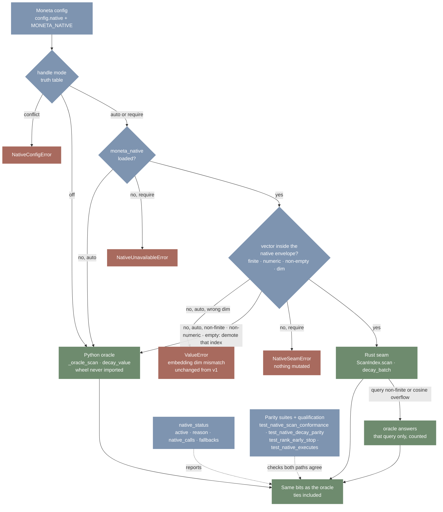

### Build, test, measure

**1. Build the wheel** (needs `rustup`, MSVC build tools on Windows, and `pip install maturin`):

```bash
cd rust/moneta_native
cargo test --release
maturin build --release -o dist
pip install --force-reinstall dist/moneta_native-*.whl   # filename varies by platform
```

**2. Run the suite in each mode** (from the repo root; keep `src` first on `PYTHONPATH`, or subprocess tests can import a stale installed `moneta`):

```bash
MONETA_NATIVE=1       PYTHONPATH=src python -m pytest tests -q -rsx
MONETA_NATIVE=require PYTHONPATH=src python -m pytest tests -q -rsx
MONETA_NATIVE=0       PYTHONPATH=src python -m pytest tests -q -rsx
```

Add `MONETA_QUAL_REPORT=<file>.json` to save the verdict, counts and identity as JSON.

**3. For a pxr interpreter such as hython:** do not install the wheel into the application. Unzip the abi3 wheel into a folder and add it to `PYTHONPATH`:

```bash
PYTHONPATH="src;<unzipped-wheel-dir>" "<hython3.11.exe>" -m pytest tests -q -p no:faulthandler -p no:cacheprovider
```

The hython rows for this branch are **PLANNED: awaiting owner coordination**. They have not been run.

**You're good when** the verdict line reads `NATIVE QUALIFIED` with the wheel under `=1` and `=require`, and `PYTHON-ONLY PASS` under `=0` and without the wheel.

### Reading the verdict line

The last block of the pytest summary is the native qualification report. Its header records the mode and env raw value; the wheel's state, version, api, path, sha256[:12] and `record_match`; `build_info`'s commit[:12], src_digest[:12] and path; the interpreter; and the `pxr` version or "absent". It also counts `native`-marked tests (collected, run, passed, skipped) and `native_fallback` tests. Then one verdict:

| Verdict | Means |
|---|---|
| `NATIVE QUALIFIED` | All hold: the wheel is loaded with `record_match` True; the mode is auto or require; 0 `native` tests skipped; the collected `native` count meets the expected total; every qualification test passed; real Rust calls for both seams are above 0; 0 unexpected fallbacks; the suite is green. |
| `NATIVE NOT QUALIFIED: <reasons>` | The wheel is loaded, but one of the above failed. The reasons name which. |
| `PYTHON-ONLY PASS (not native qualified)` | The suite is green, but the wheel is not loaded or the mode is off. |
| `PYTHON-ONLY FAIL (not native qualified): …` | The suite is red and native was not in play. |

- **`MONETA_NATIVE=require` without a loaded wheel** stops pytest at configure time with a usage error (exit code 4).
- **Native-only tests skip visibly** with the reason `moneta_native <state>: <reason>`. None vanish at collection.
- **The fallback guard:** a test that makes a native component fall back without the `native_fallback` marker fails with `unexpected native fallback: <reasons>`. The fallback counts printed in the report come from the `native_fallback` tests, which trigger them on purpose.
- **Under `MONETA_NATIVE=0` the report still shows real Rust calls.** They come from `native`-marked tests that request the backend explicitly (`backend="native"`, `ECS(native=True)`), which ignore the env. The verdict is still `PYTHON-ONLY PASS`, because the run mode is off.

### Native qualification results on this branch

All on branch `release/v1.3.0-rc2`, Python 3.14.2 on Windows, `pxr` 0.26.5, run on 2026-10-18 at the merge commit `3c01cf2979f2f33bcd1d323c7109314070157e70` (`src_digest` `58600b5811c719c9b6aee547509ae97287acededf65b6ab970c5ddc53e1420b0`, `build_info.mode` `git-src`). The two release commits change only docs and the version, so the same `src_digest` identifies `v1.3.0-rc2`. **`v1.3.0`:** the seven rows below were re-run on 2026-10-19 at the `v1.3.0` release commit, with the same wheel, and gave the same counts and verdicts; the `src_digest` is unchanged. Wheel rows use the 0.1.0 abi3 wheel installed in the interpreter's site-packages, `.pyd` sha256 `ec6d7f0c35c5b345f983f4aa80cfea086f3aca454e9cd74a58b6208227b02833`, with `src` first on `PYTHONPATH`.

| Run | Pytest | Native tests | Real Rust calls | Verdict |
|---|---|---|---|---|
| wheel, `MONETA_NATIVE=1` | 907 passed | 71/71 passed, 0 skipped; qualification 2/2 | scan 594, decay 795 (one run) | `NATIVE QUALIFIED` |
| wheel, `MONETA_NATIVE=require` | 907 passed | 71/71 passed, 0 skipped; qualification 2/2 | scan 594, decay 795 (one run) | `NATIVE QUALIFIED` |
| wheel, `MONETA_NATIVE=0` | 907 passed | 71/71 passed (explicit backends) | scan 235, decay 35 | `PYTHON-ONLY PASS (not native qualified)` |
| no wheel (`ModuleNotFoundError`), env unset | 836 passed, 71 skipped | 0 run, 71 skipped visibly | 0, 0 | `PYTHON-ONLY PASS (not native qualified)` |
| broken wheel (`ImportError`), env unset | 836 passed, 71 skipped | 0 run, 71 skipped visibly | 0, 0 | `PYTHON-ONLY PASS (not native qualified)` |
| no wheel, `MONETA_NATIVE=require` | exit 4, `MONETA_NATIVE='require' requires the native wheel` | — | — | (refused) |
| broken wheel, `MONETA_NATIVE=require` | exit 4; same prefix, the cause reads `broken: ImportError` | — | — | (refused) |
| hython 3.11, every row above | **PLANNED: awaiting owner coordination** | — | — | not run |

The absent and broken rows were produced with test shims on `PYTHONPATH` that make `import moneta_native` raise those errors. The 0 unexpected-fallback count holds in every row.

**The decay call count varies from run to run** at the same `src_digest`; 795 is the count of the one run cited here. The scan count is stable at 594.

### Attention durability: B, D and L fixed

**Undrained attention now survives a bare snapshot and a restart.** Fixed in `v1.3.0-rc2` by R1′ (`docs/design/R1-attention-durability.md`, revision 6), and shipped in `v1.3.0`.

**The normal durable path, start to finish.** Ephemeral handles skip the WAL. The failure windows in [Know the limits](#know-the-limits) still apply.

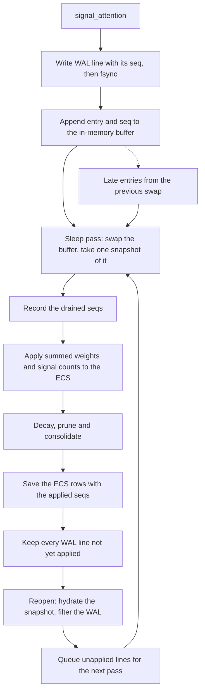

Seqs are recorded **before** the apply. A torn apply is logged (`torn attention apply`) and can lose an effect; it never silently applies one twice.

- **Path B:** `signal_attention`, then a bare save with `m.durability.snapshot_ecs(m.ecs)` (the shape of SYNAPSE's save), then a restart. rc1's save deleted the WAL. A save now keeps every WAL line whose signal the reducer has not recorded as applied, and the restart replays it once.
- **Path D:** a signal that arrives after a sleep pass has drained the attention log, but before that pass writes its snapshot, is kept the same way.
- **Path L:** an append that lands in a list the reducer has already swapped out is applied by the next pass, or at the next reopen if its appender stalls through that pass too. With one pass at a time it is never applied twice.
- Every WAL append is fsync'd before `signal_attention` returns. Windows has no directory fsync, so a power loss shortly after a save can roll back that save's renames (`docs/api.md`, Durability guarantees).
- B and D pass unmarked in `tests/integration/test_attention_snapshot_regression.py`, beside the design's §4.2 suite. `KNOWN_DEFECTS` in `tests/conftest.py` is empty.
- They are independent of the native seams: neither seam touches the WAL or the snapshot.
- **Drain, then verify, before a downgrade to rc1,** or the pending lines are lost. The behaviour changes, the rollback table and the ERROR lines are on the [operator's card](docs/OPERATOR_CARD_native.md).

**4. Measure:**

```bash
PYTHONPATH=src python scripts/bench_query.py --n 1000 10000          # v1; add --spread for aged utilities
PYTHONPATH=src python scripts/v5/bench_recall_native.py --n 10000 --queries 200   # v5
```

Operator's card with failure fixes: [`docs/OPERATOR_CARD_native.md`](docs/OPERATOR_CARD_native.md).

---

## v5 preview — journal as the database

**What it is:** `moneta.v5` is a reference implementation for the Round 4 (§9) escalation. It lives **beside v1** and changes nothing in v1. `moneta.Moneta` is still the v1 handle, and nothing has flipped on `main`.

**What it is not:** a replacement for the four-op agent API, and not released. The locked v1 decisions (four-op API, decay math, concurrency primitive, atomicity, Phase 3 envelope) have **not** changed. v5 is gated on owner rulings and open conditions; **5.0.0 is not released.**

### Three principles

| Principle | What it means |
|---|---|
| **The journal is the database** | Every change is one checksummed (CRC32), fsync'd line appended to one file. Records, the vector index and USD layers are *derived* by folding the journal, and can be thrown away and rebuilt from it. |
| **Reads are pure** | `recall` never mutates state. The decay formula is unchanged; "three evaluation points" becomes "zero mutation points: state changes only through journaled events". |
| **Prune tombstones; erase is the real delete** | A pruned or tombstoned memory leaves recall but stays in the journal and in `explain()`. `erase()` removes payload and vector from derived state, but not yet from every derived copy (E4-2, open). |

### What Round 4 added

| Addition | What it does |
|---|---|
| **Checkpoint** | `Substrate.checkpoint()` or `Config(checkpoint_every=N)` writes a fold snapshot (`src/moneta/v5/checkpoint.py`). Open then replays only the tail. `verify()` is the full integrity check, since open no longer CRC-checks lines a checkpoint covers. |
| **Half-life modes** | The journal owns the half-life. Each change is one journaled choice: `"forward"` (old decay keeps the old rate) or `"reinterpret"` (history recomputed). An open with a mismatched half-life raises `HalfLifeMismatchError`. The first sleep pass after a change is a **dry run** until confirmed. |
| **Crash-safe migration** | Whether to migrate is decided from a journaled completion marker, not from whether the journal file exists. |
| **Lock scope** | The sleep pass's USD projection and the snapshot export run with the writer lock released. |
| **Dead records** | Dead records no longer slow recall. The O(n²) dedup is fixed. |

### API sketch

Names verified against `src/moneta/v5/`. This is the v5 preview surface, not the v1 agent API.

```python
from moneta.v5 import Substrate, Config, HalfLifeMismatchError

with Substrate(Config(path="memory.v5.journal", checkpoint_every=10_000)) as m:
    eid = m.deposit("prefers concise answers", embedding, scope="projA")
    hits = m.recall(embedding, context="projA")      # RecallResult; hits.memories
    m.signal_attention({eid: 0.3})
    print(m.explain(eid, context="projA").detail)
    m.run_sleep_pass()
    m.checkpoint()                                    # open replays only the tail
    m.verify()                                        # full integrity check

# Changing the half-life is an explicit, journaled choice
with Substrate(Config(path="memory.v5.journal", half_life_seconds=3600),
               half_life_change="forward") as m:      # or "reinterpret"
    m.run_sleep_pass()                                # dry run: nothing journaled
    m.run_sleep_pass(confirm_half_life_change=True)   # applies the change
```

- **Retire or delete:** `m.tombstone(ids)` retires from recall; `m.erase(ids)` removes payload and vector from derived state, but not yet from every derived copy (E4-2, open).
- **Existing v1 consumers:** `moneta.v5.compat.Moneta` takes the unchanged `MonetaConfig`.
- **`compact()`** exists but is **not ratified** (Round 4 E4: v7 replaces it).

### Write and read flow

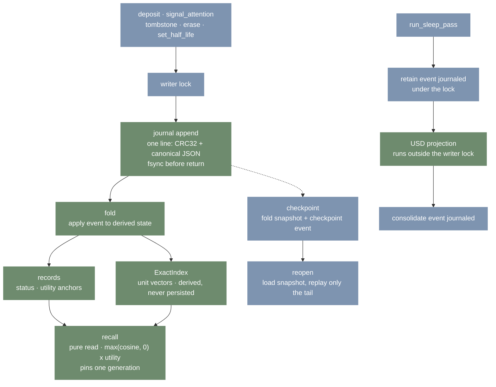

### Status: gated

The Round 4 owner rulings are in [`docs/v7/RULINGS.md`](docs/v7/RULINGS.md):

| Ruling | Decision |
|---|---|
| **E1 + E2** — journal is the authority; reads are pure | For v5, with conditions |
| **E3** — one ordered journal under a writer lock | For v5, closure gated on measured conditions |
| **E4** — prune is a tombstone; erase is the real delete | Semantics only, gated |
| **Half-life** — the journal owns it; each change is journaled | Ruled: forward or reinterpret, dry-run first pass |

The open items are in the [v1.3.0-rc1 verdict](#v130-rc1-verdict).

---

## Project structure

```
src/moneta/
├── api.py                 # Moneta handle + MonetaConfig + _ACTIVE_URIS + smoke_check
├── types.py               # Memory, EntityState
├── ecs.py                 # flat struct-of-arrays hot tier
├── decay.py               # lazy exponential decay
├── attention_log.py       # lock-free append + sleep-pass reducer
├── vector_index.py        # shadow vector index (python oracle or optional native scan)
├── durability.py          # WAL-lite snapshot + JSONL WAL
├── sequential_writer.py   # USD-first, vector-second Protocol
├── consolidation.py       # sleep-pass trigger + selection + 500-prim batch cap
├── usd_target.py          # Real USD writer (narrow lock + typed MonetaMemory authoring)
├── mock_usd_target.py     # Phase 1 JSONL authoring target (A/B fallback)
├── manifest.py            # get_consolidation_manifest delegate
├── __init__.py            # re-exports
└── v5/                    # v5 preview beside v1 (journal as the database)
    ├── substrate.py       # Substrate + Config: deposit, recall, sleep pass, checkpoint, verify
    ├── journal.py         # CRC-framed, fsync'd append-only journal + repair()
    ├── checkpoint.py      # fold snapshots, so open replays only the tail
    ├── model.py           # Record, Status, utilities_at (native decay seam)
    ├── index.py           # ExactIndex (native dot seam), derived and never persisted
    ├── policy.py          # context and scope policy resolvers
    ├── compat.py          # v1-shaped Moneta over v5, takes MonetaConfig
    └── usd/               # derived USD projection

rust/moneta_native/                # optional PyO3 abi3 wheel: ScanIndex, decay_batch
├── Cargo.toml
├── pyproject.toml
└── src/lib.rs                     # scan, dot and decay kernels (Python oracles in src/moneta/)

schema/                            # Codeless schema artifacts (v1.2.0-rc1)
├── MonetaSchema.usda              # source: concrete typed schema, 6 attrs + 4 allowedTokens
├── plugInfo.json                  # codeless plugin registration
└── generatedSchema.usda           # produced by usdGenSchema

tests/
├── unit/                                    # plain-Python + hython USD + hython schema + native contract files
├── integration/                             # 22 plain-Python + 6 hython USD
├── load/                                    # 2 — 30-min synthetic session gate
├── test_twin_substrate.py                   # 3 mock disk-backed + 1 hython real USD
├── test_twin_substrate_adversarial.py       # 10 always-run + 1 hython
├── test_attention_log_gil_guard.py          # 2 plain-Python (PEP 703 sentinel)
├── test_schema_acceptance_gate.py           # 1 hython subprocess-isolated truth condition
├── _schema_gate_subprocess.py               # subprocess body for the gate test
└── v5/                                      # v5 suite: journal, checkpoint, half-life, lock scope,
                                             #   dead records, USD, native index + decay parity
# Native contract files: tests/unit/test_native_scan_conformance.py,
#   test_native_decay_parity.py, test_rank_early_stop.py

scripts/
├── usd_metabolism_bench_v2.py    # Phase 2 benchmark + Pass 5 stress test harness
├── bench_query.py                # v1 query latency + RSS (D1 gate measurement)
├── bench_arm_p.py                # D1 arm P: numpy scan latency + exactness
└── v5/                           # v5 benches (recall_native, checkpoint, lockscope,
                                  #   dead_records, v5_vs_v1) + mutation_check.py

results/
├── bench_query_*.jsonl           # v1 native-seam measurements
└── bench_v5_*.jsonl              # v5 checkpoint, lock scope, dead records, native recall

docs/
├── api.md                       # four-op reference
├── decay-tuning.md              # λ tuning guide
├── substrate-conventions.md     # 6 conventions shared with Octavius
├── agent-commandments.md        # MoE agent discipline (8 commandments)
├── phase2-benchmark-results.md  # Phase 2 analyst interpretation
├── phase2-closure.md            # Phase 2 rulings + operational envelope
├── phase3-closure.md            # Phase 3 closure record
├── pass5-q6-findings.md         # Q6 thread-safety ruling
├── OPERATOR_CARD_native.md      # build / test / measure / off-switch for the native seams
├── v5/                          # v5 blueprint + SYNAPSE compatibility notes
├── v7/                          # BLUEPRINT_v7.md, RULINGS.md, V5_RECONCILIATION.md, Round 4 brief
└── rounds/                      # Gemini Deep Think scoping outputs
```

---

## Locked decisions

These cannot be re-opened without [§9 escalation](MONETA.md):

1. **Four-op API** — `deposit`, `query`, `signal_attention`, `get_consolidation_manifest`. No fifth op.
2. **Decay math** — `U = max(floor, U·exp(-λ·Δt))`. Three evaluation points, no fourth.
3. **Concurrency primitive** — append-only attention log, reduced at sleep pass. No locks. The lock-free swap-and-drain correctness argument requires the CPython GIL; `AttentionLog.__init__` raises `RuntimeError` under PEP 703 free-threaded Python (sentinel at `attention_log.py:64-68`, test at `tests/test_attention_log_gil_guard.py`). Free-threaded support is forward work — track via MONETA.md §9 Trigger 2.
4. **Atomicity** — sequential write (USD first, vector second). No 2PC. Orphans benign.
5. **Handle, not singleton** (`v1.1.0`) — `Moneta(config)` is the only constructor. `Moneta()` raises `TypeError`. Two handles on the same `storage_uri` raise `MonetaResourceLockedError`. In-memory `_ACTIVE_URIS` registry, not file locks.
6. **Codeless typed schema** (`v1.2.0-rc1`) — on-disk prims have `typeName="MonetaMemory"`, USD camelCase attribute names, and `priorState` as a token with four `allowedTokens` (`volatile`, `staged_for_sync`, `consolidated`, `pruned`). Schema is registered via `plugInfo.json` + `generatedSchema.usda` at runtime; no C++ build step. The schema is an externally-visible contract — changes require a §9 escalation.

**The v5 preview does not re-open any of these.** It is a reference implementation under the Round 4 §9 escalation, living beside v1. Until its gated rulings close, the six decisions above govern `moneta.Moneta`.

---

## Phase 2 verdict

**YELLOW — clean in the operational envelope, with documented graceful degradation beyond it.**

The USD benchmark measured lock-and-rebuild tax across 243 configs in 52.9 minutes on a Threadripper PRO 7965WX with OpenUSD 0.25.5. Key finding: the bottleneck is `Save()` serialization against accumulated sublayer content, not Pcp rebuild (which is effectively free at 0.1–2.6ms).

| Accumulated prims | Shadow commit | p95 stall (median) | Verdict |
|-------------------|--------------|-------------------|---------|
| 0 | 5ms | 8ms | Green |
| 0 | 50ms | 56ms | Yellow |
| 25,000 | 15ms | 78ms | Yellow |
| 100,000 | 15ms | 213ms | Yellow |
| 100,000 | 50ms | 251ms | Yellow (max 370ms) |

Phase 3 operational envelope: sublayer rotation at 50k prims, idle-window consolidation, batch cap 500, shadow commit budget ≤15ms. Within this envelope, steady-state p95 stall sits in the 50–170ms band.

Full results: [docs/phase2-benchmark-results.md](docs/phase2-benchmark-results.md) | Rulings: [docs/phase2-closure.md](docs/phase2-closure.md)

---

## Phase 3 verdict

**GREEN-ADJACENT — narrow writer lock, ChangeBlock-only scope.**

Phase 3 shipped real USD integration against OpenUSD 0.25.5. The Q6 concurrent Traverse + Save investigation (Pass 5) ruled DETERMINISTIC SAFE: 10,000 iterations, 775M prim-level concurrent read assertions, zero failures. The writer lock was shrunk from full-width (ChangeBlock + Save) to ChangeBlock-only scope (Pass 6).

| Batch size | Wide-lock p95 stall | Narrow-lock p95 stall | Reduction |
|------------|--------------------|-----------------------|-----------|
| 10 (typical) | 127–176ms | 0.6–0.8ms | **99.5%** |
| 100 | ~130ms | ~13ms | ~90% |
| 1000 | 152–217ms | 148–257ms | ~0% (ChangeBlock dominates) |

At Moneta's operational point (batch ≤ 500, accumulated ≤ 50k prims), the reader stall drops from the Phase 2 Yellow steady-state (~131ms) to a projected 10–30ms.

Full closure: [docs/phase3-closure.md](docs/phase3-closure.md)

---

## v1.1.0 — singleton surgery verdict

**SHIPPED — handle replaces singleton, multi-instance per process.**

The `v1.1.0` surgery replaced the module-level singleton (`_state` at `api.py:124` plus `PROTECTED_QUOTA = 100`) with a dependency-injected `Moneta` handle. Mixture-of-experts execution: Scout audit, Forge implementation, Crucible adversarial pass, Steward sign-off.

| Surface | Before | After |
|---|---|---|
| Plain-Python passing | 94 | **107** |
| Pxr-gated (run under hython) | 23 | **25** |
| Substrates per process | 1 | **N** |
| Two handles same URI | shared, undefined | **`MonetaResourceLockedError`** |

Empirical TOCTOU stress: 480 concurrent-construction attempts on the same URI under CPython GIL, zero double-acquisitions. Evidence under documented runtime, not proof under PEP 703 free-threading. Free-threaded TOCTOU and same-path/different-URI registry collapse are explicitly carried forward to the next surgery.

Surgery record: [SURGERY_complete.md](SURGERY_complete.md) | Audit: [AUDIT_pre_surgery.md](AUDIT_pre_surgery.md) | Design brief: [DEEP_THINK_BRIEF_substrate_handle.md](DEEP_THINK_BRIEF_substrate_handle.md)

---

## v1.2.0-rc1 — codeless schema migration verdict

**SHIPPED — typed `MonetaMemory` prims, schema-aware in usdview, gate test green in clean subprocess.**

The `v1.2.0-rc1` surgery layered a USD typed schema onto the v1.1.0 substrate. Untyped `def` memory prims become typed `MonetaMemory` prims registered through OpenUSD's plugin system. Mixture-of-experts execution: Auditor read-path audit, Crucible watched-fail acceptance gate, Schema Author authored the codeless schema, Forge implemented the typeName + token migration in `usd_target.py`, Crucible signed off after §10 conjunctive green.

| Surface | Before | After |
|---|---|---|
| Prim `typeName` on disk | `""` (typeless `def`) | `"MonetaMemory"` |
| `priorState` SDF type | `Int` (`int(EntityState.<n>)`) | `Token` (`allowedTokens` validated) |
| Attribute names | snake_case | USD camelCase (`attendedCount`, `protectedFloor`, `lastEvaluated`, `priorState`) |
| Pxr-gated tests under hython | 25 | **40** (1 acceptance gate + 3 read-path branching + 11 helper round-trip) |

Truth condition: the **acceptance gate test** (`tests/test_schema_acceptance_gate.py`) runs in a clean subprocess with `PXR_PLUGINPATH_NAME` pointing at `schema/`, asserts `Usd.SchemaRegistry().FindConcretePrimDefinition("MonetaMemory") is not None` (the false-positive defense — Sdf authoring is schema-blind and would write the typeName string with or without a registered schema), then round-trips all six attributes including the token-typed `priorState`. Operator-confirmed in usdview.

**Locked decisions in scope of this surgery:** the six attributes, the `MonetaMemory` typeName, the four `allowedTokens` (including the forward-looking `"pruned"`), the codeless registration mechanism. The schema is an externally-visible contract from `v1.2.0-rc1` forward.

**Carried forward to next surgery:** `EntityState.PRUNED` (currently absent — the `"pruned"` token is reserved by the schema but not produceable by the substrate); cross-session USD hydration; `moneta-admin upgrade-stages` CLI for legacy typeless stages.

Surgery record: [SURGERY_complete_codeless_schema.md](SURGERY_complete_codeless_schema.md) | Audit: [SCHEMA_read_path_audit.md](SCHEMA_read_path_audit.md) | Design brief: [DEEP_THINK_BRIEF_codeless_schema.md](DEEP_THINK_BRIEF_codeless_schema.md)

---

## v1.3.0 verdict

**STABLE — `v1.3.0-rc2` promoted unchanged. v1 API unchanged. Python-qualified on CPython 3.14.2 with and without the native wheel. Houdini gate C3 met on H22.0.400 (headless hython, 2026-10-19). v5 preview still gated.**

- **What changed from rc2:** the version (`1.3.0rc2` → `1.3.0`) and the docs. No `*.py` or `*.rs` file changed; the `src_digest` is the same.
- **Evidence:** the seven-row Python matrix and the v5 mutation check, re-run at the release commit on 2026-10-19 ([Status](#status)). The rc2 reviews and the owner's acceptance carry over, because the code they reviewed is the code that ships.
- **Still open:** everything in the rc2 verdict's "Open — not done" table below. The macOS `F_FULLFSYNC` gap is in the code (issue #6). The hython rows and gate 2 condition C3 were met after publication, on 2026-10-19, on H22.0.400.
- **No new binaries.** The `moneta_native` wheel is not rebuilt or attached; it stays 0.1.0 (`.pyd` sha256 `ec6d7f0c35c5…`).

---

## v1.3.0-rc2 verdict

**PRERELEASE — attention durability fixed, the attention log forced to disk, the USD mirror reopens; v1 API unchanged; v5 preview still gated.**

This release candidate is cut from branch `release/v1.3.0-rc2`, not `main`. It carries the native observability hardening, R1′ (defects B, D and L), Round 4 F1 (fsync) and the reopen-first USD repair. Release notes: [`RELEASE_NOTES.md`](RELEASE_NOTES.md).

| Surface | Before (`v1.3.0-rc1`) | After (`v1.3.0-rc2`) |
|---|---|---|
| Attention across a bare save and a restart (B, D) | lost | replayed once |
| Late landing (L) | lost | applied by the next pass, or at the next reopen |
| WAL append | buffered write, no fsync | one write plus fsync before return (~1.2 ms) |
| USD reopen in a fresh process | sublayer stack reset | existing layers opened first; stack, offsets and counts kept |
| Did Rust run? | not shown | a verdict line ends every pytest run |

**Reviewed and accepted (2026-10-18):** the Architect signed off design revision 6 (SIGNED_OFF); the re-reviews of the two code commits that landed after their reviews (`2007612`, `711d7fb`) returned SOUND-WITH-NITS; the owner accepted the rc2 content (gate 6) and the public-safety scan's history-only hit (Route A, no history rewrite). Details: [`RELEASE_NOTES.md`](RELEASE_NOTES.md), Review.

**Open — not done:**

| Item | State |
|---|---|
| hython 3.11 rows | Not run in any configuration. |
| USD repair, gate 2 condition 3 | A hython row on the target Houdini build (H22.0.400) before any Houdini seat moves. Not run. |
| USD repair review | Its own review unit (PR 2 of 2, merged in `3c01cf2`). The USD Engineer review returned SOUND-WITH-NITS; its fix-severity finding is fixed in `2007612`. Open from it: a second registry-sharing detection point for layers loaded later, `close()` releasing the root layer, a name-scoped sharing filter, drive-letter case in the stack dedup, a test for the rotation scan, and v5 projection freshness over a half-cleared store. The re-review of `2007612` and `49643c9` returned SOUND-WITH-NITS (2026-10-18) with two more, both open in code: "in place" holds only while routing selects the layer that holds the prim (a retry at a rotation-cap crossing or after a UTC day change lands in the next layer as a second, stronger copy; now stated in the notes, `docs/api.md` and the card, not yet in the `usd_target.py` docstrings), and re-authoring keeps an existing attribute's type, so an incompatible value raises at author time. |
| R1′ reviews | The Persistence and Substrate cross-review of PR 1 (design gate 3) returned SOUND-WITH-NITS; its fix-severity finding (`711d7fb`) and its nits are fixed. The Architect conformance review returned SOUND-WITH-NITS, and its nits are fixed. The Architect signed off design revision 6 on 2026-10-18 (SIGNED_OFF; one fix and six nits, applied to the design as a revision 6 erratum after the sign-off), and the re-review of `711d7fb` and `3da0053` returned SOUND-WITH-NITS. Open from them, for a later rc: a keyed retry after an interrupt past step 0's `os.replace` (today that handle degrades until reopened, logged at ERROR), and the macOS row below. |
| Windows directory fsync | Unavailable. A power loss shortly after a save can roll back its renames. |
| macOS fsync | `os.fsync` does not flush the drive's write cache on macOS, and `F_FULLFSYNC`, which gate 2 named, is not called, so the fsync guarantees hold only where fsync reaches stable storage. The design states it (§5); code and docstrings come in a later rc. |
| v5 open items | Unchanged; see the [v1.3.0-rc1 verdict](#v130-rc1-verdict). |

---

## v1.3.0-rc1 verdict

**PRERELEASE — v1 unchanged, native seams on by default behind `MONETA_NATIVE`, v5 preview gated.**

This release candidate is cut from branch `v7-native-seams`, not `main`. It adds the optional Rust seams (bit-identical to their Python oracles) and the v5 reference implementation beside v1. The seam rule is owner-confirmed (O27). The Round 4 rulings for v5 are recorded with blocking conditions; several are met and measured, pending owner acceptance. The main open items are below; the full status table is in [`docs/v7/BLUEPRINT_v7.md`](docs/v7/BLUEPRINT_v7.md) §8.

| Surface | Before (`v1.2.0-rc3`) | After (`v1.3.0-rc1`) |
|---|---|---|
| v1 query p95, 10k × 384 | 227–313 ms | **3.1–6.7 ms** with the wheel, bit-exact |
| v1 resident memory | ~185 MB | **~69 MB** with the wheel |
| v5 | not in the repo | reference implementation beside v1 |
| Test configurations | plain Python + hython | **4** (Python 3.14 and hython 3.11, native on and off), 405 passing in each |

**Open — not done:**

| Item | State |
|---|---|
| **E3-1** — sleep pass stall | Partial. A sleep pass with 1000 prunes stalls recall 73 ms against a 30 ms budget. Proposed fix: build the re-packed index outside the lock. |
| **E4-2** — erase reach | `erase()` does not yet reach every derived copy. |
| **E1-B1** — reopen budget | Missed at 99k records: 1.09 s against 1 s. |
| **v5 defect** — zero-vector slot winner | A zero-vector slot winner hides its slot. |
| **Other open conditions** | E1-B2, E1-B5, E1-P1–P3, E3-B1–B4. |
| **v5 defect** — cross-interpreter drift | Last-bit score drift between Python 3.11 and 3.14. Native and Python agree on each interpreter; the two interpreters differ from each other. |

Rulings: [docs/v7/RULINGS.md](docs/v7/RULINGS.md) | Blueprint: [docs/v7/BLUEPRINT_v7.md](docs/v7/BLUEPRINT_v7.md) | Reconciliation: [docs/v7/V5_RECONCILIATION.md](docs/v7/V5_RECONCILIATION.md) | Operator's card: [docs/OPERATOR_CARD_native.md](docs/OPERATOR_CARD_native.md)

---

## Lineage

Round 1 (scoping brief) → Round 2 (Gemini Deep Think architectural spec) → Round 2.5 (Claude prior-art review) → Round 3 (Gemini Deep Think validation) → **Phase 1** (5 passes, 94 tests, `v0.1.0`) → **Phase 2** (benchmark, `v0.2.0`) → **Phase 3** (7 passes, narrow lock, 775M-assertion safety, `v1.0.0`) → **Singleton surgery** (Scout / Forge / Crucible / Steward, `v1.1.0`) → **Codeless schema migration** (Auditor / Crucible / Schema Author / Forge, `v1.2.0-rc1`) → **Free-threading guard** (PEP 703 sentinel on `AttentionLog`, commit `76da067`, `v1.2.0-rc2`) → **Documentarian followup** (api.md handle rewrite + CLAUDE.md hard-rule update, commit `6cb1fd1`) → **Cosine clamp** (`c4a6218`, `v1.2.0-rc3`) → **Native seams** (Rust behind exact Python oracles, seam rule O27) → **v5 merged beside v1** (journal as the database) → **Round 4 rulings** (E1–E4 + half-life, `docs/v7/RULINGS.md`) → **`v1.3.0-rc1`** (prerelease from `v7-native-seams`) → **Native observability hardening** (one loader, per-handle selection, qualification harness, Gate B; base `a4f2b0b`) → **R1′ attention durability + F1 fsync + USD reopen-first** → **`v1.3.0-rc2`** (prerelease from `release/v1.3.0-rc2`) → **`v1.3.0`** (stable; rc2 promoted unchanged, from `release/v1.3.0`).

---

## Related docs

| Document | Purpose |
|---|---|
| [MONETA.md](MONETA.md) | Build blueprint — phasing, risks, roles, escalation |
| [ARCHITECTURE.md](ARCHITECTURE.md) | Locked spec — source of truth for implementation |
| [docs/api.md](docs/api.md) | Four-op API reference with examples |
| [docs/decay-tuning.md](docs/decay-tuning.md) | λ tuning guide with curves |
| [docs/substrate-conventions.md](docs/substrate-conventions.md) | 6 conventions shared with Octavius |
| [docs/phase2-closure.md](docs/phase2-closure.md) | Phase 2 verdict + operational envelope |
| [docs/phase3-closure.md](docs/phase3-closure.md) | Phase 3 closure + pass-by-pass record |
| [SURGERY_complete.md](SURGERY_complete.md) | `v1.1.0` singleton-to-handle surgery record |
| [SURGERY_complete_codeless_schema.md](SURGERY_complete_codeless_schema.md) | `v1.2.0-rc1` codeless schema surgery record |
| [`schema/`](schema/) | `MonetaSchema.usda` + `plugInfo.json` + `generatedSchema.usda` (codeless typed schema) |
| [docs/OPERATOR_CARD_native.md](docs/OPERATOR_CARD_native.md) | Native seams: build, test, measure, off switch, failure fixes |
| [docs/v5/BLUEPRINT.md](docs/v5/BLUEPRINT.md) | v5 design: the journal is the database |
| [docs/v7/BLUEPRINT_v7.md](docs/v7/BLUEPRINT_v7.md) | v7 paper |
| [docs/v7/RULINGS.md](docs/v7/RULINGS.md) | Owner rulings: O27 seam rule, Round 4 E1–E4, half-life |
| [docs/v7/V5_RECONCILIATION.md](docs/v7/V5_RECONCILIATION.md) | How merged v5 reconciles with the blueprint |

---

## License

Proprietary. Patents pending.

---

*Built from the inside out. Substrate-first. Ship Moneta.*
